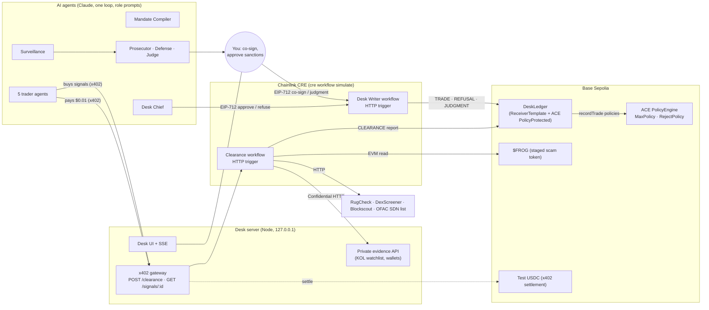

# Due Process

**Licences, budgets, a Desk Chief and a court for autonomous trading agents.**

Who is accountable when an AI agent trades? Due Process is the regulator, the clearing desk, the supervising boss and the
court for a desk of five AI trading agents. Every trade pays for a pre-trade check that runs as a Chainlink CRE
workflow, needs the AI Desk Chief's signature (and yours above a size limit), and is recorded on a public ledger
contract that enforces the rules itself. When surveillance finds abuse, an AI prosecutor, defense and judge try the case
on recorded evidence, and a human approves the sanctions before they are written on-chain.

> **Simulated.** The agents make practice trades with paper money. Influencer personas and news are synthetic. Built for
> the BLI Legal Tech Hackathon 2 (LegalTech & RegTech). Not financial or legal advice.

## What happens in the demo

| Beat | What you see | What enforces it |
|---|---|---|
| Six influencers push `$FROG` | The KOL Narrative trader trusts four of them and proposes a buy. It pays $0.01 over x402 for clearance. The CRE workflow finds that four promoters received `$FROG` from its deployer before posting, that the deployer can still mint and holds most of the supply: **BLOCKED** and recorded. | CRE clearance workflow (Confidential HTTP evidence, on-chain data, rule verdict) → `CLEARANCE` report on DeskLedger |
| Two outlets confirm a WIF story | The News Checker buys $200 of WIF. Cleared, approved by the Chief, and because it is above $150 **you co-sign** it. | EIP-712 signatures of the Chief and the human, checked by DeskLedger |
| WIF falls 18% | The Dip Buyer buys the dip. Approved: two traders in one coin is the desk's limit. | Same |
| Whales pile into WIF | The Whale Tracker's trade passes clearance, but the **Desk Chief refuses**: a third trader in WIF would concentrate the desk. The refusal, with its reason, is recorded on-chain. | Chief-signed `REFUSAL` report |
| The Meme Hunter sells a tip | It sells a POPCAT signal to two agents over x402, then buys POPCAT itself in three $90 pieces, each under the Chief's $100 auto-approve limit. *(Its orders are scripted and labelled STAGED.)* | Recorded as auto-approved trades |
| Surveillance and court | Three alerts (front-running inside its 30-minute embargo, split trades, position over its cap). Prosecutor charges the Meme Hunter and the Chief (failure to supervise). Each defendant's Defense answers from its own recorded words. The Judge rules and proposes sanctions; **you approve**: the Meme Hunter's bond is slashed and its licence suspended, the Chief loses auto-approve for 24 hours. | Human-signed `JUDGMENT` reports; DeskLedger slashes, suspends, revokes |

## Architecture



**What the contract enforces by itself** (it records a rejection as an event instead of reverting, because the CRE
simulation forwarder swallows reverts and the rejection is the evidence): a trade needs a clearance for the same trader
and token that is not BLOCKED and not used; the Chief's signature unless the clearance is CLEARED and the trade is at or
under the auto-approve limit while auto-approve is not revoked; the human's co-signature above the threshold; allocation
left; an active licence; and the ACE policies (per-trade ceiling $1,500, denylisted tokens). Judgments need the human's
signature.

**What the desk enforces off-chain**: each trader's compiled mandate (per-trade size, per-coin position, pool size,
trades per hour, the 30-minute signal embargo). The Chief reviews these exact breaches before it signs; trades that pass
on the auto-approve rule skip that review, which is the loophole the court case is about.

## Sponsor technology, and where it is load-bearing

| Technology | Use |
|---|---|
| **Chainlink CRE** | Two TypeScript workflows. *Clearance*: HTTP trigger, **Confidential HTTP** for the desk's private evidence (bearer token as a CRE secret), HTTP to RugCheck / DexScreener / Blockscout / the OFAC SDN crypto-address list in node mode with identical consensus, an EVM read of the token, a rule verdict, and a `CLEARANCE` report written to DeskLedger. *Desk Writer*: HTTP trigger, writes `TRADE`, `REFUSAL` and `JUDGMENT` reports. Both run through `cre workflow simulate` (the paid-gateway pattern); logs are kept under `proof/`. |
| **x402** (v2, `@x402/hono`, `@x402/fetch`) | Every clearance costs $0.01 test USDC, paid from the trader's own wallet (EIP-3009, the facilitator pays gas). The clearance id **is** the payment nonce, so each on-chain clearance maps to the USDC transfer that paid for it. Signals between agents are sold over x402 to the seller's wallet; those sales are the evidence of front-running. A request that fails is never charged. |
| **Chainlink ACE** | DeskLedger is `PolicyProtected`; a `PolicyEngine` runs `MaxPolicy` (per-trade ceiling) and `RejectPolicy` (denylist) on every trade, and policy rejections are recorded with their reason. |
| **RYO-CHAN directions** | One trader per direction: KOL Narrative, Whale Tracker, News Checker, Meme Hunter, Dip Buyer. The clearance workflow covers token distribution, LP lock, mint / freeze authority, liquidity and coordinated shilling. |
| **Claude** (Opus 5.5) | Every agent, with structured outputs. Answers are validated against role rules before they are cached; a committed replay cache (`data/replay/agents.jsonl`) makes the demo replay identically and offline. |

## Legal design

- **Licences on-chain.** Each trader's mandate text (`data/traders.json`) is registered on DeskLedger as a hash; the
  Mandate Compiler turns it into exact limits and red-teams them with ten trades that must each be caught by a
  deterministic checker (not the model). Any that slips through is reported as a defect.
- **Four eyes.** The Chief signs every approval and refusal (EIP-712, its own key); trades above $150 also need the
  human's signature.
- **Evidence, not vibes.** Surveillance detectors are deterministic. Exhibits are built from recorded trades, x402 sales,
  licences and prices, and court agents see them without ids or clock times (so a case replays).
- **No invented law.** The court may cite only `data/law/references.json`: the desk licence terms, MiCA Arts. 89 / 91 /
  92, FINRA Rules 5270 and 3110, and SEC Rule 10b-5, marked "by analogy". A charge or ruling that cites anything else, or
  an exhibit that does not exist, is rejected before it is accepted.
- **Due process.** Each defendant gets a defense that answers every count. Sanctions are limited to what the ledger can
  do (slash up to the $1 bond, suspend a licence, revoke the Chief's auto-approve) and need the human appeals judge's
  approval and signature.
- **A tamper-evident record.** Every step is appended to a hash-chained JSON trail; the trail head is the `trailHash` of
  each trade and the `caseHash` of each judgment. `GET /trails/:id` recomputes the chain.

## Run it

Prerequisites: Node 24+ (tested on 26; the server uses `node:sqlite`), [Bun](https://bun.sh), [Foundry](https://getfoundry.sh), the
[CRE CLI](https://docs.chain.link/cre) (`cre login`), and an Anthropic API key.

```bash
git clone --recurse-submodules <this repo> && cd due-process
npm install && (cd contracts && npm install) && (cd workflows/clearance && bun install) && (cd workflows/desk-writer && bun install)
cp .env.example .env
npx -w server tsx ../scripts/gen-wallets.ts     # testnet wallets into .env (prints addresses only)
npx -w server tsx ../scripts/sync-cre-env.ts    # CRE CLI secrets into workflows/.env
npm run test:all
```

**Local rehearsal** (no funds needed; the UI shows red "offline payments" and "local simulation" labels):

```bash
anvil &                                          # local chain for the EIP-712 domain
set -a && . ./.env && set +a
cast rpc anvil_setBalance "$(cast wallet address --private-key "$DESK_PRIVATE_KEY")" 0x56BC75E2D63100000 --rpc-url http://127.0.0.1:8545
(cd contracts && FORWARDER=0xf39Fd6e51aad88F6F4ce6aB8827279cffFb92266 DEPLOY_NAME=local \
  forge script script/Deploy.s.sol --tc Deploy --rpc-url http://127.0.0.1:8545 --broadcast)
npm run build && DEPLOYMENT=local X402_OFFLINE=1 npm start -w server
# open http://127.0.0.1:8787 and press "Run the Frog Day scenario"
```

Headless: `DEPLOYMENT=local npm run scenario -- --cosign approve --sanctions approve --offline-payments`.

**Live on Base Sepolia**: fund the desk wallet with at least 0.02 test ETH and 10 test USDC, then

```bash
npm run deploy:base-sepolia                      # DeskLedger, ACE policies, $FROG, licences, bonds, budgets, trader USDC
npm run build && DEPLOYMENT=base-sepolia CRE_CLEARANCE_TARGET=base-sepolia CRE_DESK_TARGET=base-sepolia CRE_BROADCAST=1 \
  npm start -w server
```

`npm run reset` clears local state; `npm run reset -- --redeploy` also redeploys (a judgment's 24-hour revocation and a
suspended licence cannot be rolled back on-chain).

## Evidence

`proof/` holds the CRE simulation logs and rehearsals: x402 against the public facilitator, the clearance workflow on real
token data, the gateway running CRE end to end, live Mandate Compiler output, the Chief's four ledger paths on a local
chain, the ledger-truth check (a trade the contract rejected is reported as rejected), EIP-712 digests matching the
contract, the full scenario and the court.

## Security notes

- Testnet keys only, kept in the gitignored `.env`. The CRE CLI runs with an allow-listed environment, so wallet keys and
  the Anthropic key never reach it; the Anthropic key is read from its file for that one variable only.
- The server listens on 127.0.0.1. Human-only actions (start a run, co-sign, approve sanctions) also require a custom
  header, so other websites open in the same browser cannot trigger them.
- In ledger mode the server books a trade only when the receipt contains DeskLedger's `TradeRecorded` (or
  `TradeRefused` / `JudgmentRecorded`) event, and reads auto-approve and licence status from the contract.

## Licences

This project's code is MIT (`LICENSE`). Chainlink ACE (`contracts/lib/chainlink-ace`) is **Business Source License 1.1**:
non-production use is permitted, and it converts to MIT on 6 October 2029. This project is a testnet demonstration.
